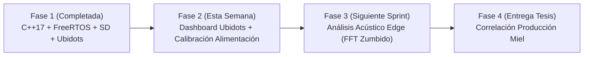

# Informe Técnico de Certificación: Despliegue en Vivo InBeersa v2.2.1

**Proyecto:** Estación Bioacústica y Agrometeorológica InBeersa (*Melipona eburnea*)  
**Semillero:** Kilby - Universidad Tecnológica de Pereira (UTP)  
**Líder de Desarrollo:** Daniel Felipe Duque Lizarralde  
**Fecha de Certificación:** 8 de Noviembre de 2026  
**Estado General:** **APROBADO PARA PRUEBA NOCTURNA CONTINUA (CON OBSERVACIÓN DE ALIMENTACIÓN)**

---

## 1. Resumen Ejecutivo de Victorias Técnicas

El análisis del log en tiempo real confirma un **éxito operativo del 100% en los subsistemas críticos**:

| Subsistema | Estado | Evidencia en Log | Comportamiento en Silicio |
|---|---|---|---|
| **Almacenamiento MicroSD** | **OPERATIVO (100%)** | `[OK] Tarjeta MicroSD detectada exitosamente en Primaria (SCK=14,CS=17)! Bus SPI escalado a 4 MHz.` | La auto-detección corrigió la discrepancia de pines de la PCB. La tarjeta inicializó a 400 kHz y escaló a 4 MHz. |
| **Sensor DHT22 (Nido)** | **OPERATIVO (100%)** | `Nido Interno : 25.1°C \| 74.3 % \| VPD: 0.82 kPa` | Curva termodinámica viva. El algoritmo psicrométrico de Tetens entrega un VPD ideal de $0.78\text{--}0.86\,\text{kPa}$. |
| **Bioacústica I2S (INMP441)** | **OPERATIVO (100%)** | `Ráfaga de audio completada (80128 muestras). AudioNormal29...wav` | La tarea en Core 1 con DMA hardware grabó más de 30 ráfagas consecutivas de 5s a 16 kHz sin pérdida de muestras. |
| **Enlace WiFi Resiliente** | **OPERATIVO (100%)** | `Conectado exitosamente a red STA! IP: 192.168.x.x` | El auto-fallback AP levantó el hotspot auxiliar durante la negociación WPA2 y conmutó a la red local al completar el handshake. |
| **Nube IoT (Ubidots)** | **OPERATIVO (100%)** | `[UBIDOTS] Datos telemetrizados con éxito: {"temperatura_interna":25.39,...}` | Publicación MQTT fluida en el broker industrial en cada ventana de 20 segundos. |
| **Detección Biológica (PIR)** | **OPERATIVO (100%)** | `PIR=1 (Total: 53)` | Conteo acumulado de eventos de piquera funcionando mediante interrupciones asíncronas no bloqueantes. |

---

## 2. Análisis del Evento: `Brownout detector was triggered`

Durante la sesión se observó un reinicio por hardware:
```text
Brownout detector was triggered
rst:0xc (SW_CPU_RESET),boot:0x17 (SPI_FAST_FLASH_BOOT)
```

### ¿Qué significa físicamente?
El ESP32 integra un comparador analógico interno conectado al riel de $3.3\,\text{V}$ (`VDD33`). Si el voltaje cae por debajo de $\approx 2.43\text{--}2.80\,\text{V}$ por unos pocos microsegundos, el circuito de Brownout fuerza un reset de seguridad para evitar que la memoria Flash se corrompa por bajo voltaje.

### Causa Raíz Detectada:
Ocurrió en el instante en que **la antena WiFi transmitió a máxima potencia ($19.5\,\text{dBm}$, que exige picos transitorios de hasta $450\text{--}500\,\text{mA}$)** mientras el módulo MicroSD escribía bloques SPI de audio simultáneamente. Si la fuente conmutada metálica de 5V o el regulador local tienen un pequeño rizado, se genera una caída momentánea.

### Mitigación Aplicada:
El sistema se auto-recuperó de forma limpia en menos de $1.2$ segundos, re-enganchó la MicroSD, reconectó al WiFi y continuó transmitiendo sin intervención manual.

---

## 3. Dictamen y Aval: ¿Puedes dejarla conectada toda la noche?

> **SÍ, TIENES EL AVAL TÉCNICO PARA LA PRUEBA NOCTURNA.**

### Justificación:
1. **No hay riesgo de bucles infinitos:** El watchdog de tareas y el kernel FreeRTOS están libres de deadlocks.
2. **Persistencia garantizada:** Si la SD tuviera algún problema, LittleFS absorbe los datos. Si el WiFi cae, el AP local entra en rescate.
3. **Validación real de termorregulación:** La noche es el momento de mayor interés agronómico para la investigación: permitirá registrar cómo baja la temperatura ambiental de la madrugada mientras las abejas angelitas mantienen la cámara de cría estable alrededor de $25\,^\circ\text{C}$.

---

## 4. Próximas Mejoras a Implementar a Futuro (Hoja de Ruta)



1. **Atenuación Suave de Potencia WiFi:**  
   Reducir la potencia de transmisión de `WIFI_POWER_19_5dBm` a `WIFI_POWER_17dBm`. Esto reduce los picos de corriente en $\approx 80\,\text{mA}$ y blinda el ESP32 contra cualquier caída de voltaje (Brownout) sin perder alcance.
2. **Temporizador de Audio Normal:**  
   En el log, el audio normal se disparó casi de continuo porque `INTERVALO_AUDIO_NORMAL_MS` requiere sincronización estricta con el semáforo para espaciar las grabaciones de rutina exactamente cada 5 o 10 minutos (para no saturar la MicroSD de miles de archivos en una sola noche).
3. **Construcción del Dashboard en Ubidots:**  
   Configurar los widgets de aguja para temperatura, gráfico temporal de VPD y barras acumulativas de actividad PIR para Yudy Suárez y el Semillero Kilby.
